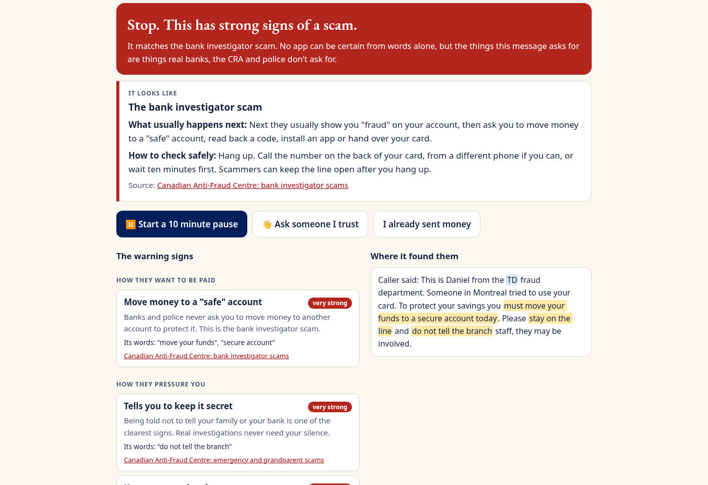

# Scam Pause

**Before you send money, pause.**

Someone wants money, a code or your card, and they want it now. Paste the text or describe the call, and Scam Pause shows each warning sign in plain words with its Canadian source, names the scam it fits, starts a ten minute pause and writes a message to someone you trust. It runs on your device and sends nothing.

Live: https://alenzacodes.github.io/scam-pause/ · Video: see DEVPOST.md



## What it does

* 26 warning signs from the Canadian Anti-Fraud Centre, the CRA and Canada Post, each explained and linked to its source
* names eight scam stories (bank investigator, fake CRA, grandparent, delivery, task job, crypto investment, recovery, phishing) and says what usually comes next
* checks links without opening them: lookalikes, punycode, other alphabets, borrowed brand names, odd endings, shorteners
* phone call mode with three quick questions
* a ten minute pause with a checklist, a message to a trusted person with links, codes and card numbers removed, and steps for anyone who already paid
* honest wording: it never says a message is safe
* no account, no server, nothing pasted is stored; `connect-src 'none'` blocks every request

## How well it does

On synthetic messages written for this project:

| Set | Scams flagged | Real messages left alone | Right story |
| --- | --- | --- | --- |
| Development, 72 messages | 40 of 40 | 32 of 32 | 37 of 37 |
| Held out, 24 messages written after the rules were frozen | 13 of 14 | 10 of 10 | 8 of 9 |

Real scams change their wording, so expect it to do worse on real messages. It reads words, not voices, and cannot verify who sent a message. It is not an emergency service: in danger, call 911.

## Run it

```
python3 -m http.server 8000
```

Open http://localhost:8000. Add `?speed=40` to speed up the pause for a demo.

## Test it

```
node --test                         # 11 tests: signs, stories, links, redaction, both message sets, security policy
python3 scripts/browser_check.py    # headless Chrome check of the whole app (needs Playwright)
python3 scripts/browser_check.py --shots   # also saves the gallery screenshots in docs/
python3 scripts/record_demo.py      # records the captioned demo
```

## Files

| File | What it does |
| --- | --- |
| `src/signals.js` | The warning signs, with weights, reasons and sources |
| `src/links.js` | Web address checks |
| `src/engine.js` | Scoring, scam stories, honest wording, redaction, the trusted person message, call questions |
| `src/corpus.js`, `src/holdout.js` | The two synthetic message sets |
| `src/evaluate.js` | Scores a set |
| `src/app.js` | The interface |

## Sources

* Canadian Anti-Fraud Centre: https://antifraudcentre-centreantifraude.ca/
* CRA, recognize a scam: https://www.canada.ca/en/revenue-agency/corporate/scams-fraud/recognize-scam.html
* Canada Post, fraudulent emails and texts: https://www.canadapost-postescanada.ca/cpc/en/support/kb/company-policies/privacy-security/what-do-to-if-you-get-suspicious-email.page

## Credits

Built by John Khan in Toronto, Ontario, for SafeSpace Hacks (October 2026). The page theme in `src/theme/` comes from my earlier projects. Written with help from an AI coding assistant. Every message and name in it is made up. MIT licence.
